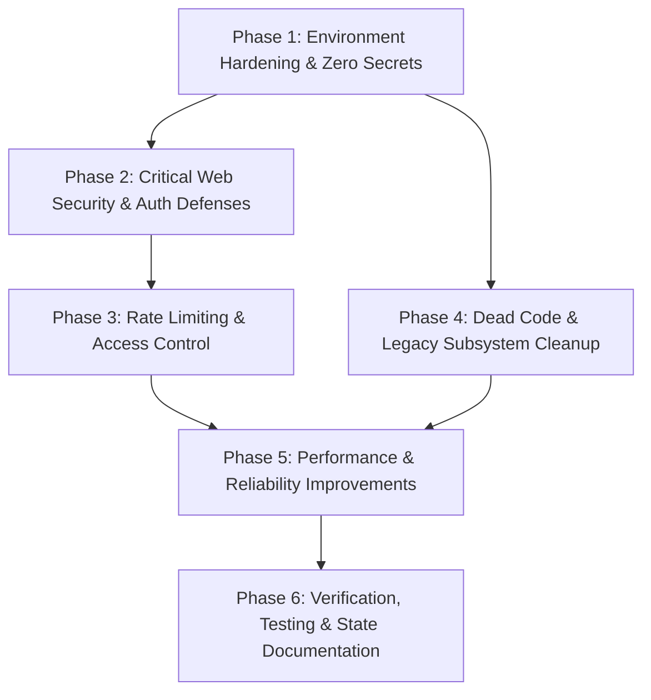

# Implementation Plan: Security Hardening & Architectural Refactoring

**Project**: IAMS / AAS-Project  
**Author**: Pair Programming with Antigravity  
**Target Architecture**: Spring Boot 3.5.4, Java 17, MySQL 8.4, Docker Compose  
**Date**: October 2026  

---

## Executive Summary

This implementation plan resolves the security vulnerabilities and structural issues identified during the repository audit of the UTM AAS / IAMS codebase. It strictly adheres to the principle of **Zero Secrets in Source Control**, ensuring all credentials, tokens, and sensitive configurations are managed exclusively via `.env` and environment variables.

The plan is organized into six sequential, verifiable phases:
1. **Phase 1: Environment Hardening & Secret Externalization** (Zero hardcoded secrets outside `.env`)
2. **Phase 2: Critical Web Security & Authentication Defenses** (CSRF, Host Header Injection, Token Expiry, CSV Injection, Open Redirect, XSS)
3. **Phase 3: Rate Limiting & Access Control Fortification** (Brute-force protection, IP spoofing fix, UserDetails role collision)
4. **Phase 4: Dead Code Elimination & Legacy Cleanup** (Removal of commented-out Industrial Supervisor files & dead controllers)
5. **Phase 5: Performance Optimization & Reliability Improvements** (Database aggregation queries, Null-safe sorting, Local dev profiles)
6. **Phase 6: Verification, Testing & State Documentation** (Automated testing, Regression verification, Updating `STATE.md`)

---

## Phase 1: Environment Hardening & Secret Externalization

### Objective
Ensure that **no sensitive information exists outside `.env`**, remove hardcoded credentials and tokens from Java source code, and eliminate plaintext credential logging.

### Detailed Tasks

#### 1.1 Secure Super Admin Bootstrap Credentials
* **Affected File**: `adproject/src/main/java/com/capstone/adproject/config/SuperAdminBootstrapRunner.java`
* **Issues**:
  * Hardcoded default email (`ihsan.rubix@gmail.com`) and password (`Admin@12345`).
  * Password logged in plaintext to application logs on startup.
* **Implementation**:
  * Inject `@Value("${app.bootstrap.superadmin.email:}")` and `@Value("${app.bootstrap.superadmin.password:}")`.
  * If either property is blank, skip auto-creation and log an informative notice: `"Bootstrap skipped: BOOTSTRAP_SUPERADMIN_EMAIL or BOOTSTRAP_SUPERADMIN_PASSWORD not set."`.
  * Remove the plaintext password from the log output. Only log the email of the created account.

#### 1.2 Externalize Remember-Me Secret Key
* **Affected File**: `adproject/src/main/java/com/capstone/adproject/config/SecurityConfig.java`
* **Issue**:
  * Static hardcoded secret: `private static final String REMEMBER_ME_KEY = "utm-cas-remember-me-secret-key-2025-DO-NOT-CHANGE";`.
* **Implementation**:
  * Inject key via `@Value("${app.security.remember-me-key:}")`.
  * Implement a fallback that securely generates a random 256-bit key on application startup if no explicit key is provided in `.env`, ensuring cookies cannot be forged using publicly known repository keys.

#### 1.3 Externalize Mail Sender Identity
* **Affected File**: `adproject/src/main/java/com/capstone/adproject/service/EmailService.java`
* **Issue**:
  * Hardcoded sender address `helper.setFrom("admin@eduinnovax.com")` in lines 30, 66, 109, and 153.
* **Implementation**:
  * Inject `@Value("${spring.mail.from:${spring.mail.username:admin@example.com}}") private String mailFrom;`.
  * Use `helper.setFrom(mailFrom)` across all email construction methods.

#### 1.4 Update `.env.example`, `.env`, and Property Mappings
* **Affected Files**:
  * `adproject/.env.example`
  * `adproject/src/main/resources/application-prod.properties`
  * `adproject/src/main/resources/application.properties` (New default configuration)
  * `adproject/docker-compose.yml`
* **Implementation**:
  * Expand `adproject/.env.example` to document all environment keys with zero real credentials:
    ```bash
    # MySQL Database Configuration
    MYSQL_ROOT_PASSWORD=replace-me-with-secure-password
    SPRING_DATASOURCE_URL=jdbc:mysql://mysql:3306/aas_db?useSSL=false&allowPublicKeyRetrieval=true&serverTimezone=UTC
    SPRING_DATASOURCE_USERNAME=root

    # Super Admin Bootstrap (Initial setup only)
    BOOTSTRAP_SUPERADMIN_EMAIL=
    BOOTSTRAP_SUPERADMIN_PASSWORD=

    # Application Security Keys
    APP_SECURITY_REMEMBER_ME_KEY=

    # Mail Configuration
    SPRING_MAIL_HOST=smtp.gmail.com
    SPRING_MAIL_PORT=587
    SPRING_MAIL_USERNAME=
    SPRING_MAIL_PASSWORD=
    SPRING_MAIL_FROM=

    # Public Application URL (Used for reset links & notifications)
    APP_PUBLIC_BASE_URL=http://localhost:8080

    # System Alerts
    ADPROJECT_ALERTS_ENABLED=true
    ADPROJECT_ALERTS_RECIPIENT_EMAIL=
    ADPROJECT_ALERTS_THRESHOLD_CRITICAL_ERRORS=10
    ```
  * Forward the new variables in `adproject/docker-compose.yml` under `app.environment`.

### Acceptance Criteria
- [ ] No hardcoded passwords, emails, or cryptographic secrets remain in Java files.
- [ ] Bootstrap account creation requires explicit `.env` variables and logs no credentials.
- [ ] Running `git grep -i "Admin@12345"` and `git grep -i "utm-cas-remember-me-secret-key"` yields zero matches.

---

## Phase 2: Critical Web Security & Authentication Defenses

### Objective
Remediate CSRF bypasses, Host Header Injection, password reset token weaknesses, CSV injection, open redirects, and XSS risks.

### Detailed Tasks

#### 2.1 Convert Mutating GET Endpoints to CSRF-Protected POST Requests
* **Affected Files**:
  * `adproject/src/main/java/com/capstone/adproject/controller/AdminController.java`
  * `adproject/src/main/resources/templates/manage_students.html`
  * `adproject/src/main/resources/templates/manage_lecturers.html`
  * `adproject/src/main/resources/templates/edit_group.html`
* **Implementation**:
  * Replace `@GetMapping("/delete-student/{id}")` with `@PostMapping("/delete-student/{id}")`.
  * Replace `@GetMapping("/delete-lecturer/{id}")` with `@PostMapping("/delete-lecturer/{id}")`.
  * Replace `@GetMapping("/group/remove-student/{studentId}")` with `@PostMapping("/group/remove-student/{studentId}")`.
  * Update Thymeleaf templates to use `<form th:action="..." method="post">` with standard CSRF hidden tokens (or button forms) instead of raw `<a>` tags.

#### 2.2 Neutralize Host Header Injection in Password Reset Links
* **Affected Files**:
  * `adproject/src/main/java/com/capstone/adproject/controller/AuthController.java`
  * `adproject/src/main/java/com/capstone/adproject/service/AdminService.java`
* **Implementation**:
  * Inject `@Value("${app.public-base-url:http://localhost:8080}") private String publicBaseUrl;`.
  * In `AuthController.processForgotPassword` and `AdminService.sendWelcomeEmail`, replace `request.getScheme() + "://" + request.getServerName()` with `publicBaseUrl.replaceAll("/+$", "")`.
  * Ensure reset link is safely constructed as: `publicBaseUrl + "/reset_password?token=" + token`.

#### 2.3 Strengthen Password Reset Token Security
* **Affected Files**:
  * `adproject/src/main/java/com/capstone/adproject/model/` (`Admin.java`, `SuperAdmin.java`, `Lecturer.java`, `Student.java`)
  * `adproject/src/main/java/com/capstone/adproject/service/UserService.java`
  * `adproject/src/main/java/com/capstone/adproject/controller/AuthController.java`
* **Implementation**:
  * Add token expiration timestamp column `resetPasswordTokenExpiry` (`LocalDateTime`) to user entities.
  * In `UserService.generateResetToken`:
    * Generate cryptographically secure random token: `UUID.randomUUID().toString()`.
    * Store the SHA-256 hash of the token in the database, with `expiry = LocalDateTime.now().plusMinutes(30)`.
    * Return the raw unhashed token strictly for email transmission.
  * In `UserService.findUserByResetToken`:
    * Hash incoming token with SHA-256 before database lookup.
    * Verify `LocalDateTime.now().isBefore(user.getResetPasswordTokenExpiry())`.
  * In `AuthController.processForgotPassword`:
    * Replace user enumeration message (`"No user found with that email address"`) with a uniform response: `"If an account with that email exists, a password reset link has been sent."`.

#### 2.4 Neutralize CSV / Formula Injection (CWE-1236)
* **Affected File**: `adproject/src/main/java/com/capstone/adproject/controller/DataViewController.java`
* **Implementation**:
  * Update `escapeCsv(String value)` method:
    ```java
    private String escapeCsv(String value) {
        if (value == null) {
            return "";
        }
        String str = value.trim();
        // Prevent CSV Formula Injection
        if (str.startsWith("=") || str.startsWith("+") || str.startsWith("-") || 
            str.startsWith("@") || str.startsWith("\t") || str.startsWith("\r")) {
            str = "'" + str;
        }
        if (str.contains(",") || str.contains("\"") || str.contains("\n") || str.contains("\r")) {
            return "\"" + str.replace("\"", "\"\"") + "\"";
        }
        return str;
    }
    ```

#### 2.5 Mitigate Open Redirect in Course Switcher and Role Assignment
* **Affected File**: `adproject/src/main/java/com/capstone/adproject/controller/AdminController.java`
* **Implementation**:
  * Sanitize redirect target extracted from `request.getHeader("Referer")`:
    * Ensure string starts with `/` and not `//`.
    * If URL contains hostname, verify it matches local host / configured application domain.
    * Fall back safely to `redirect:/admin/home`.

#### 2.6 Eliminate Unescaped HTML (`th:utext`) in Template
* **Affected File**: `adproject/src/main/resources/templates/supervisor_continuous_evaluation.html`
* **Implementation**:
  * Change `th:utext="${rubric.getRubricCommentLabel(i)}"` and `th:utext="${commentLabels[i]}"` to `th:text`.

### Acceptance Criteria
- [ ] Deleting students or lecturers via direct GET URL returns HTTP 405 Method Not Allowed.
- [ ] Password reset links in emails strictly use `app.public-base-url`.
- [ ] Password reset tokens expire after 30 minutes and are stored hashed in MySQL.
- [ ] Exporting CSV with cells starting with `=SUM(...)` or `@cmd` prepends `'` preventing formula execution.
- [ ] Open redirects via spoofed `Referer` headers are blocked.

---

## Phase 3: Rate Limiting & Access Control Fortification

### Objective
Protect authentication endpoints against credential stuffing and brute-force attacks, fix IP resolution vulnerabilities, and prevent authority collision across user tables.

### Detailed Tasks

#### 3.1 Expand Rate Limiting to Authentication Endpoints
* **Affected Files**:
  * `adproject/src/main/java/com/capstone/adproject/config/WebMvcConfig.java`
  * `adproject/src/main/java/com/capstone/adproject/config/RateLimitConfig.java`
* **Implementation**:
  * Define an authentication-specific rate limit bean in `RateLimitConfig.java` (e.g., 5 attempts per minute).
  * Register rate limiting interceptor for `/login`, `/forgot_password`, and `/reset_password` in `WebMvcConfig.java`.

#### 3.2 Secure Client IP Resolution in Rate Limiting
* **Affected File**: `adproject/src/main/java/com/capstone/adproject/interceptor/RateLimitInterceptor.java`
* **Implementation**:
  * Remove `!xfHeader.contains(".")` check which improperly rejected IPv6 addresses.
  * Add configuration flag `app.security.behind-proxy: false`. Only trust `X-Forwarded-For` when `behind-proxy` is explicitly enabled; otherwise default to `request.getRemoteAddr()`.

#### 3.3 Harmonize UserDetails Lookup to Prevent Privilege Confusion
* **Affected File**: `adproject/src/main/java/com/capstone/adproject/service/CustomUserDetailsService.java`
* **Implementation**:
  * Refactor `loadUserByUsername` to follow strict priority order:
    1. Super Admin
    2. Admin
    3. Lecturer
    4. Student
  * Prevent silent overwriting of passwords and uncontrolled authority merging when an identifier exists in multiple tables. If an account has elevated credentials (SuperAdmin/Admin), prioritize that entity's password and roles deterministically.

### Acceptance Criteria
- [ ] Repeated requests to `/forgot_password` or `/login` beyond the configured limit trigger HTTP 429 Too Many Requests.
- [ ] IPv6 client addresses are properly parsed and rate limited.
- [ ] User role resolution is deterministic and prevents cross-table privilege confusion.

---

## Phase 4: Dead Code Elimination & Legacy Cleanup

### Objective
Remove commented-out code, delete obsolete controllers and entities from previous migrations, and clean up technical debt identified in `STATE.md`.

### Detailed Tasks

#### 4.1 Delete Commented-out and Empty Controller/Service Files
* **Files to Delete**:
  * `adproject/src/main/java/com/capstone/adproject/controller/IndustrialSupervisorController.java` (entire file commented out with `/*ackage ... */`)
  * `adproject/src/main/java/com/capstone/adproject/service/IndustrialSupervisorService.java` (entire file commented out with `/*package ... */`)
  * `adproject/src/main/java/com/capstone/adproject/controller/TestController.java` (empty 0-byte file)
  * `adproject/src/main/resources/templates/industrial_supervisor_home.html` (obsolete view)

#### 4.2 Deprecate and Clean Industrial Supervisor Domain References
* **Affected Files**:
  * `adproject/src/main/java/com/capstone/adproject/model/IndustrialSupervisor.java`
  * `adproject/src/main/java/com/capstone/adproject/repositories/IndustrialSupervisorRepository.java`
  * `adproject/src/main/java/com/capstone/adproject/service/AdminService.java`
* **Implementation**:
  * Confirm all group supervisor assignments point to `Lecturer` (as completed in Phase 07/08 documented in `STATE.md`).
  * Remove the unused `IndustrialSupervisor` entity and repository to prevent Hibernate from maintaining the redundant database table.
  * Remove obsolete supervisor-specific helper methods from `AdminService.java`.

### Acceptance Criteria
- [ ] No `/*ackage` or `/*package` commented-out files exist in the repository.
- [ ] Application compiles cleanly without missing dependency warnings.

---

## Phase 5: Performance Optimization & Reliability Improvements

### Objective
Eliminate in-memory heap bottlenecks, ensure null safety in calculations, and establish a clean local development profile.

### Detailed Tasks

#### 5.1 Replace In-Memory Filtering with Database Aggregation Queries
* **Affected Files**:
  * `adproject/src/main/java/com/capstone/adproject/repositories/StudentRepository.java`
  * `adproject/src/main/java/com/capstone/adproject/repositories/LecturerRepository.java`
  * `adproject/src/main/java/com/capstone/adproject/repositories/AssessmentRepository.java`
  * `adproject/src/main/java/com/capstone/adproject/repositories/GroupRepository.java`
  * `adproject/src/main/java/com/capstone/adproject/service/CourseStatisticsService.java`
* **Implementation**:
  * Add repository methods:
    * `long countByCourseId(Long courseId);`
  * In `CourseStatisticsService.getCourseStatistics`, replace:
    ```java
    long studentCount = studentRepository.findAll().stream().filter(...).count();
    ```
    with:
    ```java
    long studentCount = studentRepository.countByCourseId(course.getId());
    ```
  * Repeat for lecturers, assessments, and groups.

#### 5.2 Implement Null-Safe Sorting in CalculateService
* **Affected File**: `adproject/src/main/java/com/capstone/adproject/service/CalculateService.java`
* **Implementation**:
  * In line 60, replace:
    ```java
    students.sort((s1, s2) -> s1.getUsername().compareToIgnoreCase(s2.getUsername()));
    ```
    with:
    ```java
    students.sort(Comparator.comparing(
        s -> s.getUsername() != null && !s.getUsername().isBlank() ? s.getUsername() : s.getEmail(),
        String.CASE_INSENSITIVE_ORDER
    ));
    ```

#### 5.3 Create Base `application.properties` for Local Development
* **New File**: `adproject/src/main/resources/application.properties`
* **Implementation**:
  * Configure default properties pointing to `localhost:3306` with `ddl-auto=update` and local dev server settings.
  * Keep `application-prod.properties` strictly for containerized and production environments.

### Acceptance Criteria
- [ ] Course statistics dashboard loads without executing full table scans in memory.
- [ ] Calculating assessment data for students without usernames succeeds without throwing `NullPointerException`.
- [ ] Running the application locally outside Docker connects smoothly to `localhost:3306`.

---

## Phase 6: Verification, Testing & State Documentation

### Objective
Validate system stability across all user flows, verify zero secret leakage, and document updated project state.

### Detailed Tasks

#### 6.1 Automated & Integration Testing
* Run `make check-env` to ensure environment passes all diagnostics.
* Run `make test` to verify unit and security test suites pass.
* Test all user roles in Docker (`make dev`):
  * **SuperAdmin**: Course creation, admin invitation.
  * **Admin**: Student/Assessor management, rubric creation, CSV export, mark overrides.
  * **Assessor**: Group and student rubric evaluations.
  * **Student**: Self, peer, and group assessments.

#### 6.2 Secret Leak Audit
* Execute automated scan for accidental credentials:
  ```bash
  git grep -E -i "password\s*=\s*['\"][^'\"]+['\"]" -- ':!*.properties' ':!*.sql'
  ```
* Verify `.env` is listed in `.gitignore` and has not been tracked in git history.

#### 6.3 Update `STATE.md`
* Document the completed Security Hardening & Architectural Refactoring milestone in `adproject/STATE.md`.

---

## Phase Dependency & Execution Order


